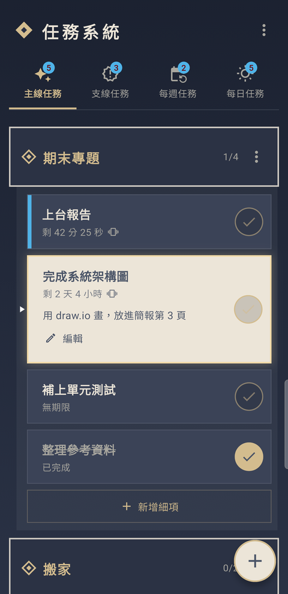
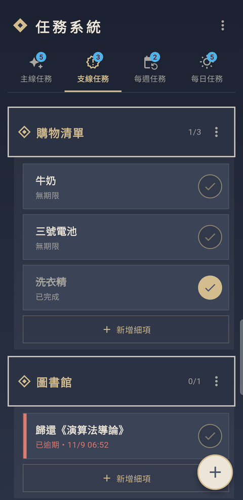
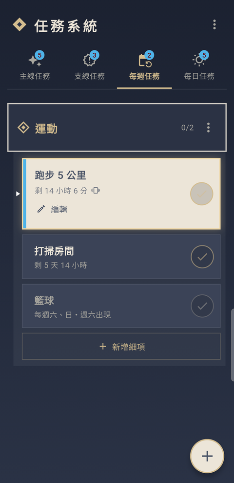
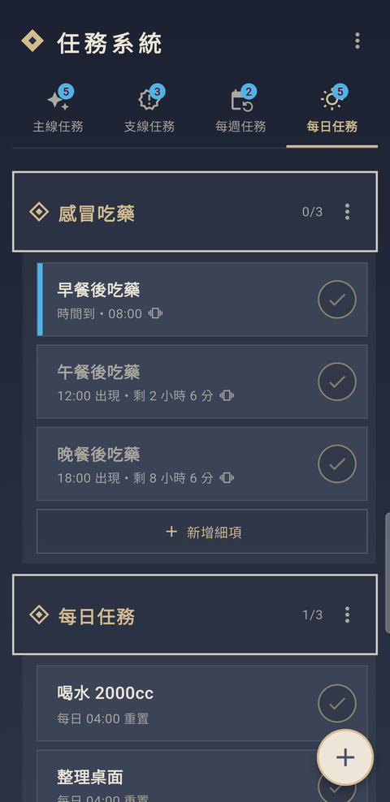
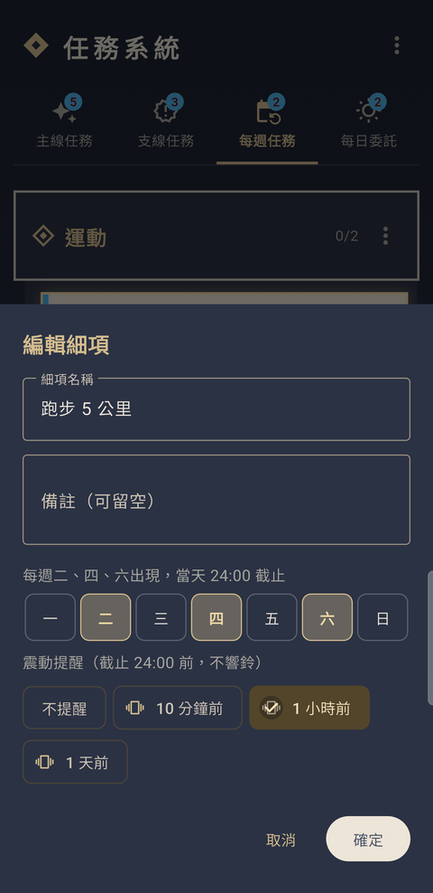
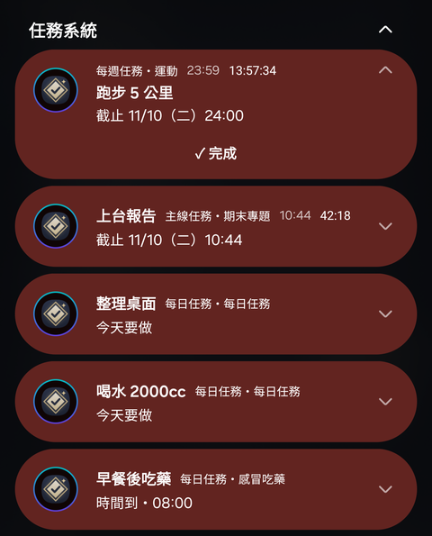

<p align="center">
  
</p>

<h1 align="center">任務系統</h1>

<p align="center">
  把待辦事項變成任務清單，未完成的任務常駐在通知欄，<br>
  拉下通知欄就知道還有什麼要做，做完直接打勾。
</p>

<p align="center">
  <a href="https://github.com/partner0487/TaskSystem/releases/latest"><b>⬇ 下載最新版 APK</b></a>
  ・Android 7.0 以上
</p>

<p align="center">
  
  
  
  
  
</p>

---

## 特色

### 📌 任務常駐在通知欄
每個還沒完成的任務都會安靜地待在通知欄：不響鈴、不跳出，但一拉下來就看得到。
展開通知就能直接按 **「✓ 完成」**，不用打開 App。
不小心滑掉了？它會自己回來。重開機後也會自動補回。

<p align="center">
  
</p>

### 🗂️ 四種任務，大事件底下再分細項
| 分類 | 適合 | 規則 |
|---|---|---|
| **主線任務** | 重要的事：專題、考試、搬家 | 可設期限與提醒 |
| **支線任務** | 零碎的事：購物清單、還書 | 可設期限與提醒 |
| **每週任務** | 固定的習慣：每週一三五運動 | 選星期幾，只在那幾天出現，當天 24:00 截止 |
| **每日任務** | 每天都要做：喝水、背單字、吃藥 | 每天凌晨 4:00 重新出現；可設「每天幾點」，時間到才出現並震動提醒 |

每個「大事件」（例如「期末專題」）底下可以有多個「細項」（例如「完成系統架構圖」），一步一步完成。

### ⏳ 一眼看出還剩多久
- 倒數會隨時間變精細：**剩 2 天 5 小時 → 剩 5 小時 30 分 → 剩 12 分 30 秒**
- 24 小時內到期，卡片左側出現**藍色條**，通知上也會顯示倒數計時
- 已經逾期會變成**紅色**；逾期 7 天後自動移出通知欄，但 App 裡仍保留，由你決定要補做還是刪除
- 沒有期限的任務也可以，當成記事本使用

### 💊 每天固定時間的任務
生病要飯後吃藥？在每日任務新增「午餐後吃藥 12:00」「晚餐後吃藥 18:00」：
- 時間到才出現在通知欄，並**準時震動提醒**（也可以提早 10／30 分鐘）
- 時間還沒到時，App 裡會變暗並倒數；提早吃了也可以先打勾，當天就不會再提醒
- 每一次分開打勾，中午吃了、晚上那次還在

### 📳 只震動、不吵人的提醒
截止前 **10 分鐘／1 小時／1 天** 震動提醒，不會響鈴。
想改成有聲音？到 Android 設定 → 通知 → 任務系統 → 到期提醒，自己調整。

### 🔁 自動重置，不用每天重新輸入
- 每日任務每天凌晨 4:00 重新出現（熬夜到凌晨 3 點，今天的任務還在）
- 每週任務只在選定的日子出現，其他日子會變暗、不能打勾
- App 沒開也會照時間出現與消失

### 🛟 用得安心
- 刪除、打勾按錯了？下方會出現 **「復原」**
- 一鍵**匯出備份**成一個檔案，換手機時再**匯入**即可
- 所有資料只存在你的手機裡，不需要帳號、不連網路

---

## 下載與安裝

1. 到 [Releases](https://github.com/partner0487/TaskSystem/releases/latest) 下載 `TaskSystem-vX.Y.Z.apk`，點開安裝
2. 如果跳出「不允許安裝不明應用程式」，依畫面指示允許這次安裝
3. 如果 Play Protect 警告「未知的開發人員」，點「更多詳細資料 → 仍要安裝」
4. 第一次打開時**允許通知**，任務才會出現在通知欄
5. 建議把電池設為**不受限制**（App 裡 ⋮ → 背景執行設定 → 電池），通知欄的「完成」才會穩定運作

## 使用方式

| 想做的事 | 操作 |
|---|---|
| 新增大事件 | 點右下角的 ＋ |
| 新增細項 | 點大事件底下的「新增細項」 |
| 完成細項 | 點卡片右側的 ✓，或在通知欄按「✓ 完成」 |
| 查看備註 | 點一下細項卡片 |
| 編輯細項 | 點一下細項卡片，再按「✎ 編輯」 |
| 刪除細項 | 細項卡片往左滑 |
| 排序 | **長按**細項卡片或大事件標題，拖曳到想要的位置 |
| 編輯／刪除大事件 | 大事件標題右邊的 ⋮ |
| 清除已完成 | 右上角 ⋮ → 清除已完成 |
| 備份／還原 | 右上角 ⋮ → 匯出備份／匯入備份 |

## 常見問題

**通知欄沒有出現任務？**
App 頂端如果有紅色提示，表示通知被關掉了，點「開啟」即可。

**在通知欄按「完成」沒反應、滑掉後沒有彈回？**
通常是手機的省電機制擋住了背景執行。到 ⋮ → 背景執行設定 → 電池，設為「不受限制」。

**更新 App 後通知欄的任務不見了？**
Android 在更新 App 時會清掉它的通知，通常會在幾秒內自動補回；
少數情況下（例如更新時 App 正開著）系統會漏掉這一步，只要打開 App 一次就會全部回來。

**每日任務沒有準時在 4:00 出現？**
為了省電，系統可能會晚一點（最多約 1 小時）才讓它出現；打開 App 會立刻更新。

---

## 開發

### 環境

- Flutter 3.47 以上（Dart 3.13）
- JDK 17
- Android SDK（API 37 編譯，最低支援 Android 7.0 / API 24）
- 編輯器：VS Code + Flutter 擴充套件（不需要 Android Studio）

### 專案結構

```
lib/
├── main.dart            App 進入點：初始化通知、要求權限、讀取資料；開機補發通知的入口
├── models.dart          資料結構（分類、大事件、細項）與時間規則：重置、期限、倒數、提醒
├── store.dart           狀態管理：新增／修改／刪除／排序／復原都經過這裡，並同步通知欄
├── storage.dart         存檔讀寫（shared_preferences，存成 JSON）
├── notifications.dart   通知欄：常駐通知、預約重置、震動提醒、「✓ 完成」與滑掉彈回
├── backup.dart          匯出／匯入備份檔的格式與檢查
├── system.dart          呼叫 Android 原生功能（電池設定、版本號、開網址）
├── demo.dart            展示模式的資料（截圖用）
├── theme.dart           配色
└── ui/
    ├── home_page.dart   主畫面：分類分頁、任務列表、拖曳排序、設定提示
    ├── widgets.dart     菱形圖示、大事件標題、細項卡片、勾選按鈕
    └── edit_sheets.dart 新增／編輯用的底部表單

android/app/src/main/kotlin/…/
├── MainActivity.kt      原生功能的實作（給 system.dart 用）
└── BootReceiver.kt      開機／更新後，在背景把通知補回通知欄
```

### 在手機上執行

1. 手機開啟**開發人員選項**：設定 → 關於手機 → 軟體資訊 → 連點「版本號碼」7 次
2. 開發人員選項 → 打開 **USB 偵錯**
3. Samsung 手機要另外關閉：設定 → 安全性與隱私 → **自動封鎖程式**
4. 用 USB 線接上電腦，手機上按「允許 USB 偵錯」
5. 在 VS Code 開啟本專案，確認右下角選到你的手機，按 **F5**

修改 Dart 程式碼後存檔即可**熱重載**；修改通知相關的程式碼請按 **Ctrl + Shift + F5** 熱重啟；
修改 `android/` 底下的檔案（圖示、App 名稱、權限）則需要停止後重新按 F5。

### 常用指令

```bash
flutter pub get                          # 安裝套件
flutter run                              # 在已連接的手機上執行
flutter run --dart-define=DEMO=true      # 展示模式（用另一份示範資料，不動到真實資料）
flutter test                             # 執行測試
flutter analyze                          # 靜態檢查
flutter build apk --release --split-per-abi   # 打包 APK（輸出在 build/app/outputs/flutter-apk/）
```

### 使用的套件

- [flutter_local_notifications](https://pub.dev/packages/flutter_local_notifications)：通知欄、預約通知
- [shared_preferences](https://pub.dev/packages/shared_preferences)：資料儲存
- [file_picker](https://pub.dev/packages/file_picker)：匯出／匯入備份檔
- [timezone](https://pub.dev/packages/timezone)：預約通知的時間
- flutter_localizations：日期／時間選擇器中文化
